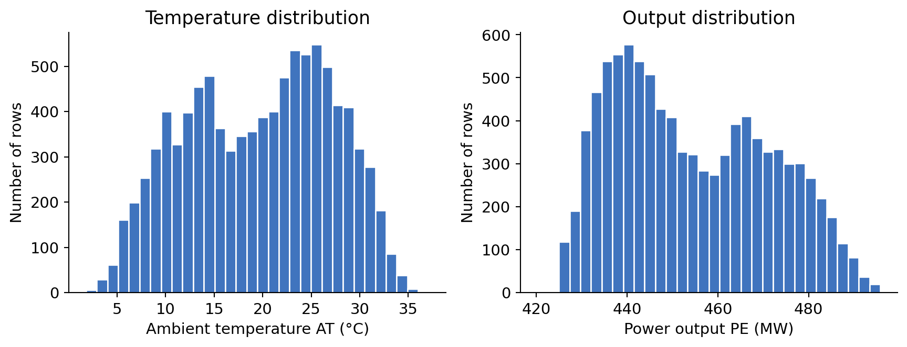
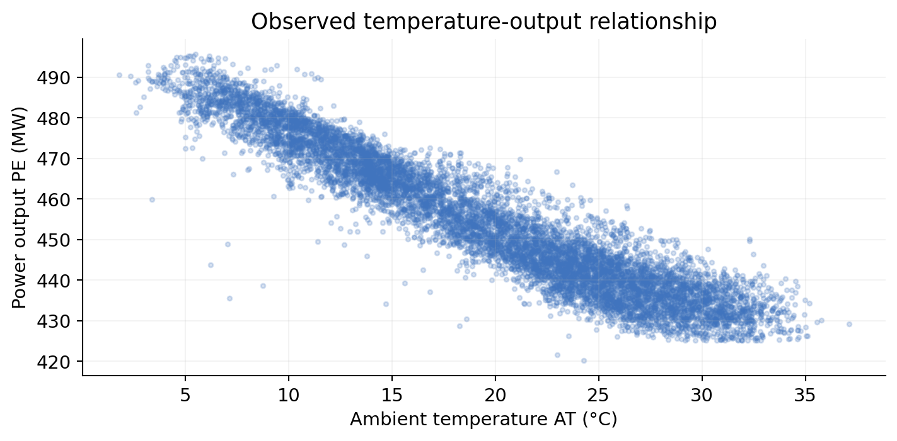
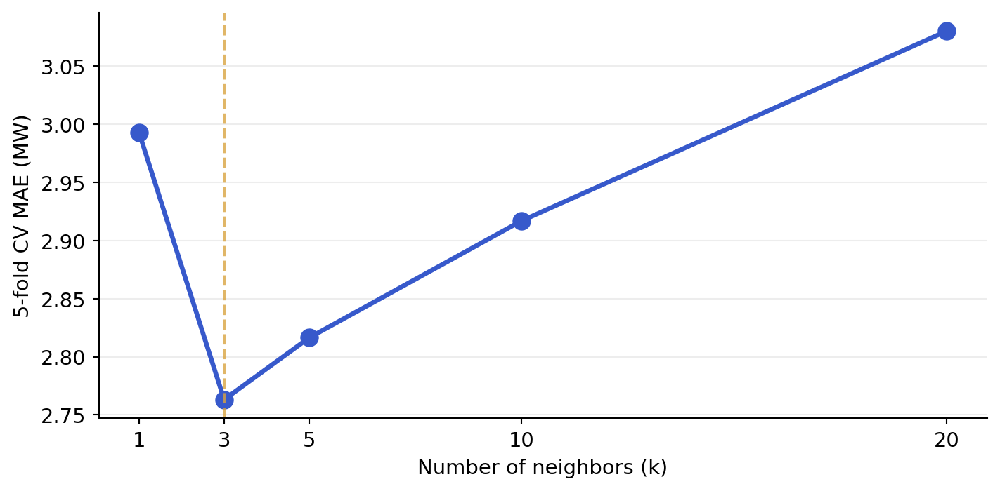
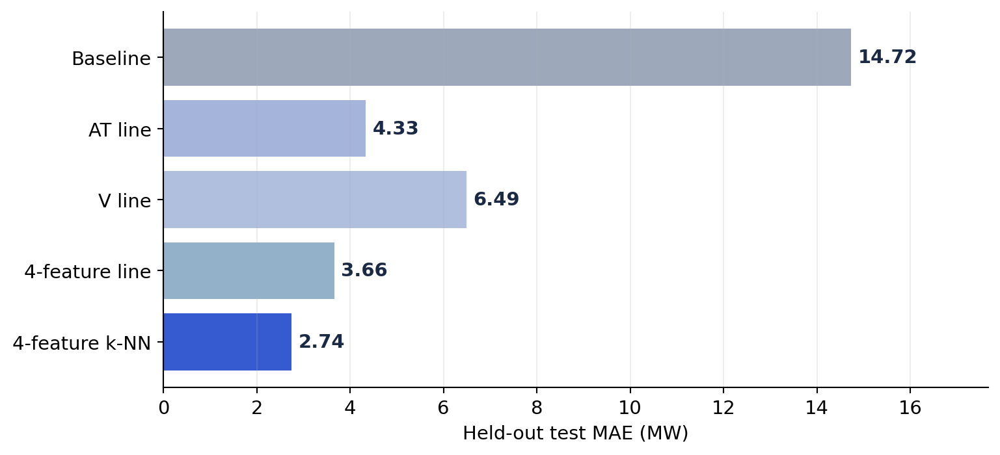
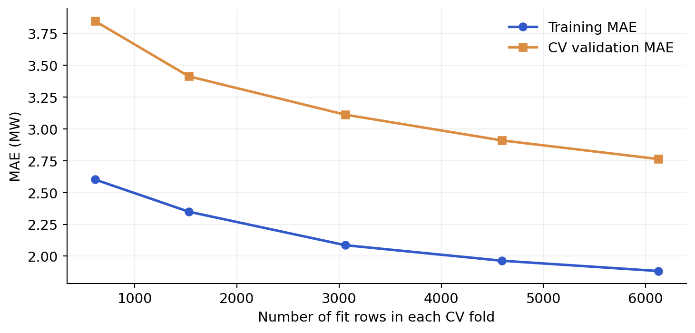
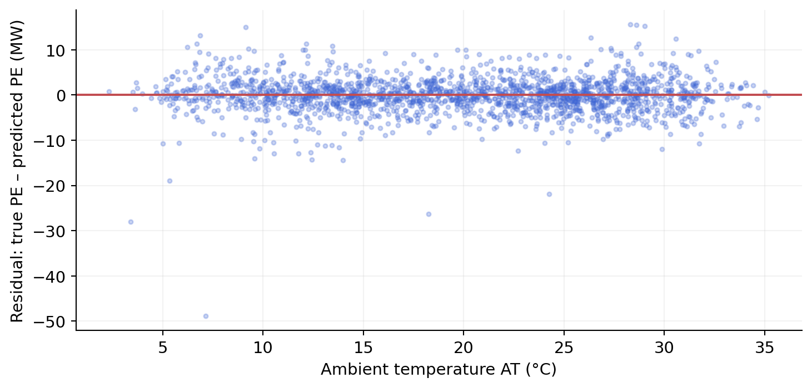
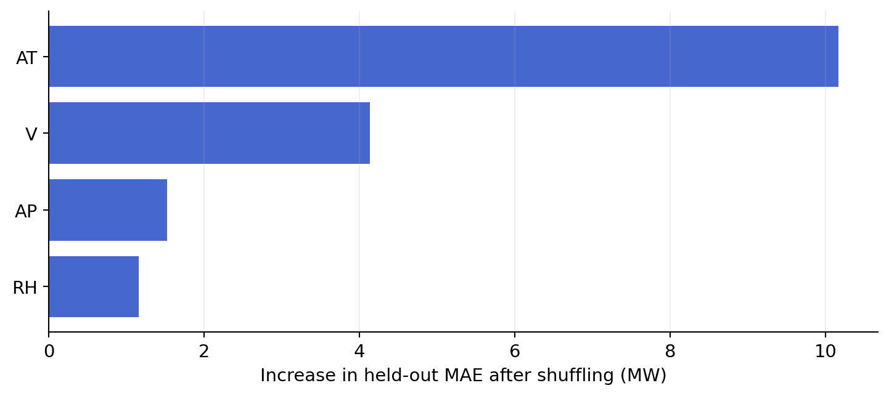

# Data and model — k-Nearest Neighbors Regression

[Home](index.html) · [Numerical problem](numerical.html) · [Presentation](presentation.html) · [Code](code.html)

## 1. Scientific task

Predict the hourly **net electrical energy output PE (MW)** of a combined-cycle power plant operating at full load. The four predictors are **AT**, **V**, **AP** and **RH**. Because the output is continuous, the task is **supervised regression**.

## 2. Data card — provenance, licence and limitations

| Field | Description |
|---|---|
| Dataset | Combined Cycle Power Plant (CCPP) |
| Creator and source | P. Tüfekci and H. Kaya; [UCI Machine Learning Repository](https://doi.org/10.24432/C5002N) |
| Original study | Full-load hourly power output from a combined-cycle plant |
| Data collection | 2006–2011; one row is one hourly averaged observation |
| Size | 9,568 rows × 5 numeric columns |
| Licence | **CC BY 4.0** (credit Tüfekci and Kaya; modifications must be noted) |
| Data transformation | Original source XLSX was converted to `data/ccpp.csv`; original column order and row ordering retained |
| Missing values | 0 |
| Exact duplicate rows | 41, deliberately retained to match course reference comparisons |
| Known issue | 16 distinct held-out test rows also occur in training (duplicate overlap). Apparent generalization may be optimistic. RH reaches 100.16%, slightly above 100%. |
| Applicability limits | Full-load conditions at this plant; not validated for partial load, other plants, or future operating regimes |

Source and licensing detail: [`data/README.md`](data/README.md).

## 3. Exploratory data analysis

| Variable | Meaning | Unit | Minimum | Maximum | Pearson correlation with PE |
|---|---|---|---:|---:|---:|
| AT | Ambient temperature | °C | 1.81 | 37.11 | -0.948 |
| V | Exhaust vacuum | cm Hg | 25.36 | 81.56 | -0.870 |
| AP | Ambient pressure | mbar | 992.89 | 1033.30 | +0.518 |
| RH | Relative humidity | % | 25.56 | 100.16 | +0.390 |
| PE | Net electrical output | MW | 420.26 | 495.76 | 1.000 |

- AT mean = 19.65 °C, median = 20.34 °C, sample standard deviation = 7.45 °C.
- PE mean = 454.37 MW, median = 451.55 MW, sample standard deviation = 17.07 MW.
- The numerical ranges are retained as observed; RH's maximum above 100% should be checked in the underlying measurement pipeline rather than silently removed.
- AT has the strongest simple Pearson correlation with PE. **Correlation is not causation.**





## 4. Fixed split, validation and leakage controls

Follow the course split **without shuffling** before separation: first **7,654 rows** are training and final **1,914 rows** are the final test set. The **test set is held out from model selection**. The five training folds are built via `KFold(n_splits=5, shuffle=True, random_state=0)`.

A pipeline `StandardScaler() → KNeighborsRegressor()` fits the scaler **separately inside each CV training fold**. Thus validation statistics do not enter fitting. Refit on all training data after the hyperparameter is selected, then evaluate once on the 1,914 held-out rows.

**Residual duplicate risk:** 16 test rows match training rows despite correct train/test separation. This is a known property of the dataset and fixed course split, not a claim of zero leakage. A new-group or time-separated evaluation would be appropriate before deployment.

## 5. Baselines and hyperparameter tuning

The constant baseline is `DummyRegressor(strategy="mean")`. Its training-set mean is **454.440184 MW** and its held-out MAE is **14.723152 MW**. A four-feature linear regression provides a second comparison.

**Cross-validation comparison on training data only** (mean ± *sample* standard deviation across five folds):

| Model | Training CV MAE (MW) | Held-out test MAE (MW) |
|---|---:|---:|
| Mean baseline | 14.8770 ± 0.2632 | 14.7232 |
| Four-feature linear regression | 3.6224 ± 0.0856 | 3.6594 |
| **Four-feature k-NN, best k=3** | **2.7631 ± 0.0786** | **2.7431** |

The hyperparameter search used `GridSearchCV` on k ∈ {1, 3, 5, 10, 20}, evaluated by mean training-only CV MAE:

| k | Mean five-fold CV MAE (MW) |
|---:|---:|
| 1 | 2.9926 |
| **3** | **2.7631** |
| 5 | 2.8163 |
| 10 | 2.9170 |
| 20 | 3.0803 |



**How it learns:** k-NN is instance-based and keeps the training rows. After scaling features, it computes Euclidean distances from an input to stored examples and averages the PE values of the nearest k examples:


$$
\widehat{PE}(x)=\frac{1}{k}\sum_{i\in N_k(x)} PE_i.
$$


Small k can overfit noise; very large k tends to oversmooth. Scaling matters because the predictors have different numerical ranges and measurement units.

## 6. Held-out test results

| Model | Test MAE (MW) |
|---|---:|
| Training-mean baseline | 14.723152 |
| Linear regression, AT only | 4.333265 |
| Linear regression, V only | 6.488218 |
| Four-feature linear regression | 3.659393 |
| **k-NN with k=3** | **2.743109** |

The selected k-NN model also obtains **RMSE = 3.984315 MW**. Relative to the constant mean baseline, MAE is **81.37% lower** on this fixed test set. This is a predictive comparison, not evidence of a causal relationship.



**Transparent first held-out prediction:** CSV line **7,656**, AT=6.45 °C, V=35.77 cm Hg, AP=1018.86 mbar and RH=67.84%; measured PE=483.12 MW, k-NN predicted PE=484.343333 MW, so the absolute error is **1.223333 MW**.

## 7. Diagnostics

**Learning curve:** CV validation MAE decreases from 3.847 MW (612 training rows per fit fold) to 2.763 MW (6,123 rows). Additional representative data could improve performance, but this is not guaranteed.



**Residuals:** For each held-out observation, residual = true PE − predicted PE (MW). Plotting residuals against ambient temperature can reveal systematic bias and outliers.



**Permutation importance:** Repeat each held-out-feature shuffle 10 times with a fixed seed. The following values are the *increase* in test MAE; this is post-training diagnosis only, not tuning on test data:

| Feature shuffled | MAE increase (MW) |
|---|---:|
| AT | 10.1668 |
| V | 4.1353 |
| AP | 1.5206 |
| RH | 1.1554 |



**Independent diagnostic: feature ablation.** Refit the k=3 pipeline on training folds, omitting one predictor at a time. Report cross-validated MAE (MW):

| Removed feature | CV MAE (MW) |
|---|---:|
| None | **2.7631** |
| AT | 4.7742 |
| V | 3.4204 |
| AP | 3.2378 |
| RH | 2.8940 |

AT is highly predictive under this model, consistent with permutation importance, but **these results do not prove causality**. Leakage risk from overlapping exact duplicates and the full-load-only collection remain important constraints.

## 8. Reproducibility

```bash
python lab/knn_project.py
```

This regenerates `results.json`, `knn_console_output.txt` (when the output is redirected), the plots and the exact tables. To regenerate all project results, run `python code/run_all.py`.

Reference environment: Python 3.13.5, NumPy 2.3.5, pandas 2.2.3, scikit-learn 1.8.0, Matplotlib 3.10.8. The student's local environment may differ.

**References:** P. Tüfekci and H. Kaya, “Combined Cycle Power Plant,” UCI, 2014, doi:10.24432/C5002N, CC BY 4.0; scikit-learn User Guide, [Nearest Neighbors](https://scikit-learn.org/stable/modules/neighbors.html), [Grid Search](https://scikit-learn.org/stable/modules/grid_search.html), [Permutation Importance](https://scikit-learn.org/stable/modules/permutation_importance.html); EEE213 Weeks 9–13 course slides.
