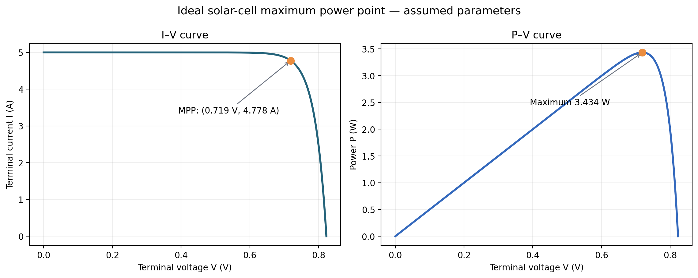
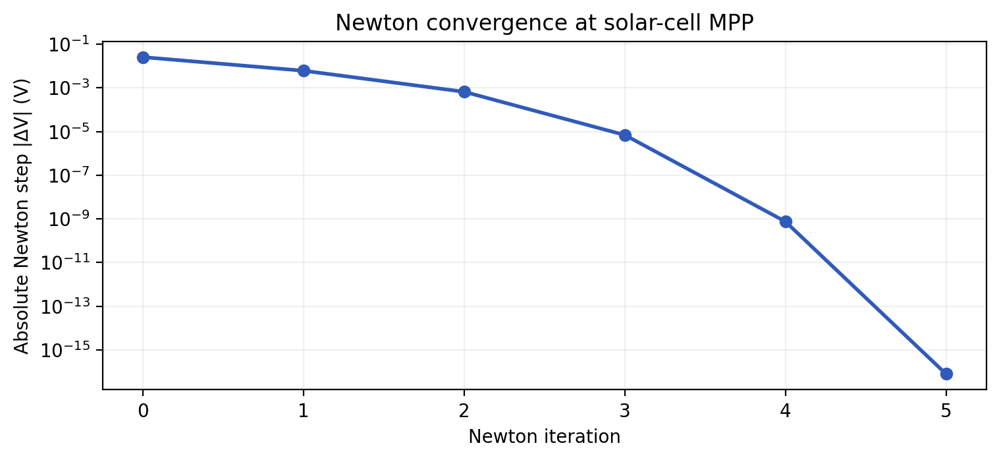

# Numerical problem #4 — Solar-cell maximum power point

[Home](index.html) · [Data and model](model.html) · [Presentation](presentation.html) · [Code](code.html)

> **Assignment condition:** This is numerical problem #4 from EEE213 Week 09. The problem is appropriate **only if the actual draw number was 4**.

## 1. Problem statement and assumptions

An illuminated photovoltaic cell is modeled with the **ideal single-diode equation** at fixed temperature and irradiance. Series resistance is neglected (`Rs = 0 Ω`), shunt resistance is infinite (`Rsh → ∞`) and the photo-generated current, saturation current and ideality factor are constant. The goal is to find terminal voltage **Vmp (V)**, current **Imp (A)** and electrical power **Pmp (W)** at the **maximum power point (MPP)**.

These assumptions describe an illustrative ideal cell. They are **not a manufacturer's datasheet parameters**.

## 2. Inputs and units

| Symbol | Meaning | Value | Units | Provenance |
|---|---|---:|---|---|
| `Iph` | Photocurrent | 5.00 | A | Stated assumption |
| `I0` | Diode saturation current | 1.00 × 10^-10 | A | Stated assumption |
| `n` | Ideality factor | 1.30 | — | Stated assumption |
| `T` | Cell temperature | 298.15 | K | Stated assumption (25 °C) |
| `kB` | Boltzmann constant | 1.380649 × 10^-23 | J/K | Exact SI defining constant |
| `q` | Elementary charge | 1.602176634 × 10^-19 | C | Exact SI defining constant |

The thermal voltage is `VT = kB*T/q = 0.025692579 V`; define `a = n*VT = 0.033400353 V`. The open-circuit voltage is `Voc = a * ln(1 + Iph/I0) = 0.822827340 V`.

## 3. Equations and derivation by hand

Ideal one-diode current–voltage equation, with current in A and voltage in V:

\[ I(V) = I_{ph} - I_0\left(e^{V/a}-1\right). \]

Power in watts is \( P(V)=V I(V) \). To find an interior maximum, set the first derivative of power to zero. By the product rule:

\[ \frac{dP}{dV} = I(V)+V\frac{dI}{dV}. \]

Differentiate the current equation:

\[ \frac{dI}{dV}=-\frac{I_0}{a}e^{V/a}. \]

Substitution gives the scalar nonlinear residual, in amperes:

\[ f(V)=I_{ph}+I_0-I_0e^{V/a}(1+V/a)=0. \]

Its **analytical derivative** is:

\[ f'(V)=-\frac{I_0}{a}e^{V/a}\left(2+\frac{V}{a}\right)\quad [\mathrm{A/V}]. \]

The derivative is negative for \(V \ge 0\), so the stationary point is a unique local power maximum in the physical interval \(0<V<V_{oc}\).

## 4. Newton–Raphson method

Start at **V0 = 0.7000000000 V** and iterate:

\[ V_{j+1}=V_j-\frac{f(V_j)}{f'(V_j)}. \]

Stop only if **both** `|Vnew - Vold| < 1e-12 V` and `|f(Vnew)| < 1e-10 A` hold, with a maximum of 50 iterations. The code checks that every step remains in `[0, Voc]`.

### Iterations (generated by `python code/numerical.py`)

| j | Vj (V) | f(Vj) (A) | f'(Vj) (A/V) | ΔV (V) |
|---:|---:|---:|---:|---:|
| 0 | 0.7000000000 | +2.223651 | -86.908929 | +0.0255859900 |
| 1 | 0.7255859900 | -1.180927 | -193.199412 | -0.0061124792 |
| 2 | 0.7194735108 | -0.105793 | -159.648183 | -0.0006626646 |
| 3 | 0.7188108463 | -0.00108656 | -156.380063 | -0.0000069482 |
| 4 | 0.7188038981 | -1.17814e-7 | -156.346152 | -7.53545e-10 |
| 5 | 0.7188038973 | -1.24345e-14 | -156.346148 | -7.95318e-17 |

### Calculated solution

| Result | Value |
|---|---:|
| **Vmp** | **0.7188038973 V** |
| **Imp** | **4.7779834876 A** |
| **Pmp = Vmp × Imp** | **3.4344331522 W** |
| Residual \(\lvert f(Vmp)\rvert\) | 4.44 × 10^-15 A |
| Second derivative \(d^2P/dV^2\) at MPP | -156.346148 A/V |

### I–V and P–V curves



### Convergence



## 5. Derivative verification and independent checks

**Analytical derivative check:** Evaluate the centered finite difference at `V = 0.65 V`, with `h = 1e-6 V`:

`f'(V) ≈ [f(V+h) - f(V-h)] / (2*h)`.

- Analytic value: `-18.182171286... A/V`.
- Finite-difference value: `-18.182171286... A/V`.
- **Absolute difference:** `3.55 × 10^-9 A/V`.

**Independent method #1 — derivative-free golden-section search:** Maximize **P(V) directly**, without Newton iterations or the residual derivative. It gives `Vmp ≈ 0.7188038995 V`, which differs from the Newton value by **2.16 × 10^-9 V**.

**Independent method #2 — dense power grid:** Evaluate P(V) at 200,001 uniformly spaced voltages between 0 and Voc. The maximum occurs at `V ≈ 0.7188055077 V`, differing by **1.61 × 10^-6 V** (within one voltage grid spacing).

Both endpoint powers are zero to numerical precision: `P(0) = 0 W`, `P(Voc) ≈ 0 W`. The power second derivative is negative at the computed stationary point.

## 6. Interpretation and limitations

The idealized cell delivers its maximum of about **3.434 W** near **0.7188 V**, below the open-circuit voltage of **0.8228 V**. The Newton result is independently validated and the finite-difference test supports the analytical derivative. Actual solar cells have series and shunt losses, temperature-dependent parameters, irradiance changes, manufacturing variation and maximum-power-point tracking dynamics. These numerical results should not be treated as commercial solar-panel specifications.

## Reproducibility

From the repository root:

```bash
python code/numerical.py
```

This generates [`numerical_results.json`](numerical_results.json), [`numerical_console_output.txt`](numerical_console_output.txt) (saved reference log in repository), the two plots, and the complete iteration table in the terminal. Source: [`code/numerical.py`](https://github.com/ulasutkuceylan/EEE213-Ulas-Utku-Ceylan-HW1/blob/main/code/numerical.py).

**Reading:** EEE213 Week 09 numerical-problem list (#4), EEE213 Week 11 numerical-page checklist; the ideal diode equation and SI constant definitions. Source parameter values are **stated assumptions**.
